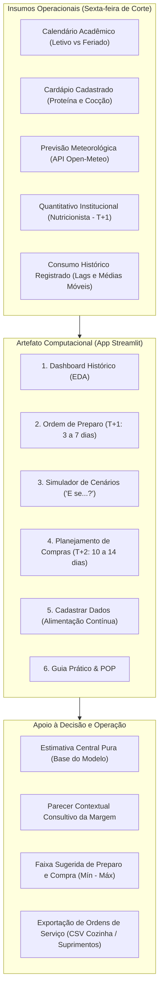

# Apresentação do Artefato Computacional na Dissertação: Guia Completo do Sistema de Apoio à Decisão (SAD)

Este documento foi elaborado para subsidiar diretamente a redação do capítulo ou seção da dissertação de mestrado que apresenta o **Artefato Computacional** (o aplicativo web desenvolvido em Streamlit). Ele detalha a arquitetura geral do sistema, os fundamentos conceituais, o funcionamento de cada uma das suas 6 telas, as melhorias implementadas e a especificação exata de quais capturas de tela (*prints*) devem ser extraídas, acompanhadas de sugestões de legendas, rastreabilidade dos notebooks e texto acadêmico de apresentação.

---

## 1. Visão Geral e Arquitetura do Artefato

### 1.1. Propósito e Filosofia de Projeto
O artefato computacional materializa a contribuição aplicada da pesquisa: transformar os achados empíricos de modelagem preditiva em um **Sistema de Apoio à Decisão (SAD / *Decision Support System - DSS*)** operacional para a gestão de um Restaurante Universitário / Estudantil.

O sistema opera sob três pilares metodológicos fundamentais:
1. **Soberania Técnica da Nutricionista e Gestão:** O modelo preditivo não substitui a decisão humana. O artefato fornece a *Estimativa Central (Base Pura)*, calcula a *Faixa Sugerida (Tolerância Heurística Operacional)* e oferece um *Parecer Contextual de Viabilidade da Margem de Segurança*, cabendo à Nutricionista Responsável Técnica (RT) e ao setor de suprimentos a validação e autorização final da ordem de preparo e compra.
2. **Simbiose Humano-Algoritmo (Modelo Híbrido):** No horizonte de curto prazo ($T+1$), o modelo adotado combina de forma linear ponderada (50/50) a estimativa algorítmica (Ridge no Cenário 2) com o planejamento institucional da nutricionista, apresentando menor erro médio absoluto (MAE) no período retrospectivo (fev-ago/2026) sob o Cenário 2 em comparação com as abordagens isoladas.
3. **Protocolo de Separação Temporal na Emissão:** O artefato segue a regra de corte temporal na sexta-feira às 14h. As médias móveis e defasagens são computadas com dados anteriores ao corte, o clima utiliza a previsão numérica da API Open-Meteo obtida e arquivada na emissão (sem uso de clima observado futuro), e eventos atípicos catalogados são mantidos em quarentena preditiva para não distorcer as entradas dos modelos.

---

## 2. Detalhamento das 6 Telas do Aplicativo

A navegação do aplicativo é organizada em 6 etapas sequenciais, acessíveis tanto pela barra superior (*header*) quanto pela barra lateral (*sidebar*).

---

### ETAPA 1: Visão Geral, Indicadores e Análise Exploratória (Dashboard EDA)

* **Objetivo Operacional:** Permitir à gestão auditar o histórico de dados (2023 a 2026), compreendendo os fatores comportamentais associados à frequência ao restaurante.
* **Componentes e Visualizações:**
  1. **KPIs Históricos Consolidados:** Volume total de refeições servidas registradas, média diária em dias letivos, quantidade de dias operacionais, maior pico histórico e menor registro auditado.
  2. **Série Temporal Completa:** Gráfico interativo com o consumo diário registrado, média móvel de 5 dias e destaque dos dias com eventos atípicos catalogados.
  3. **Diagnóstico de Sazonalidade Semanal:** Gráfico de distribuição do consumo por dia da semana, evidenciando a menor média nas sextas-feiras (~20% menor que segundas-feiras) e o comportamento dos períodos de início e final de semestre.
  4. **Atratividade do Cardápio:** Gráficos relacionando a média de comparecimento com os tipos de carnes (bovina, frango, suína, peixe, ovos) e preparos culinários.
  5. **Sensibilidade Meteorológica:** Gráficos de dispersão correlacionando precipitação pluviométrica (chuva) e temperatura máxima com a variação no número de refeições servidas.
  6. **Associação Linear dos Atributos:** Gráfico tornado com os coeficientes de correlação linear de Pearson ($r$) dos atributos em relação ao consumo registrado.
* **Captura de Tela Sugerida para a Dissertação:**
  * **O que capturar:** Visão ampla da aba do Dashboard, exibindo os KPIs do topo e o gráfico da série temporal histórica combinada com a distribuição por dia da semana.
  * **Sugestão de Legenda:** `Figura X – Interface do Módulo 1 (Dashboard EDA): Indicadores globais e análise da série histórica de frequência discente.`
  * **Texto para a IA da Dissertação destacar:**
    > *"A Figura X ilustra a interface de Análise Exploratória de Dados (EDA) do artefato. Nesse módulo, a gestão do restaurante tem acesso à auditoria visual de toda a base histórica. Destaca-se a forte sazonalidade semanal evidenciada no gráfico de dispersão, no qual as sextas-feiras apresentam média significativamente inferior à dos demais dias úteis, justificando a inclusão de defasagens e variáveis Dummy semanais nos modelos preditivos."*

---

### ETAPA 2: Previsões e Ordem de Preparo Semanal ($T+1$)

* **Objetivo Operacional:** Servir como o painel central utilizado toda **sexta-feira à tarde** pela Nutricionista Responsável Técnica para emitir a ordem de serviço da cozinha terceirizada para a semana útil seguinte (horizonte de 3 a 7 dias).
* **Parâmetros e Configurações:**
  * Seleção de Cenário (Cenário 2 = Consumo + Calendário + Cardápio como padrão oficial da pesquisa);
  * Seleção de Modelo (Modelo Híbrido 50/50 como campeão oficial);
  * Seleção da Política de Margem de Proteção (P85 como padrão, P75 econômica, P90 protetiva, Sem Margem ou Customizada).
* **Melhorias e Inovações Implementadas:**
  1. **Destaque da Estimativa Central Base Pura:** O número principal exibido nos 5 cartões diários corresponde à **estimativa central pura do Modelo Híbrido**, identificada pelo badge `Previsão Base (Híbrido)`.
  2. **Classificação Gastronômica Visual:** Cada card traz a identificação da proteína e técnica de cocção com ícones (ex.: `🥩 Bovina • Refogado / Molho`, `🍗 Frango • Assado`, `🥓 Suína • Grelhado`).
  3. **Motor de Viabilidade Contextual da Margem (`avaliar_viabilidade_margem`):**
     * Em dias de tempestade severa ($\ge 15\text{ mm}$ de chuva), o sistema emite parecer heurístico consultivo `🔴 Desaconselhada (+0 ref)`, sugerindo contenção da margem para mitigar risco de excedentes.
     * Em dias de chuva moderada ($8\text{ a }15\text{ mm}$) ou nas sextas-feiras, sugere margem econômica `🟡 Moderada (+14 ref)`.
     * Em dias secos com carne bovina/feijoada, recomenda margem plena `🟢 Recomendada (+21 ref)`.
  4. **Intervalo Operacional — Faixa Sugerida (Mín - Máx):** Exibe no card e na tabela o intervalo assimétrico delimitado por $[\max(0, \text{pred\_base} - 8), \text{recomendacao\_final} + 8]$, fornecendo à cozinha uma faixa de tolerância heurística operacional.
  5. **Tabela Operacional com Separação de Papéis:** Segrega claramente a meta da Nutrição, a previsão da IA, a previsão base híbrida, o parecer contextual da margem, a recomendação oficial com margem e a faixa sugerida.
  6. **Exportação em CSV:** Botão para gerar a ordem de preparo formatada para planilhas e impressões da equipe da cozinha terceirizada.
* **Captura de Tela Sugerida para a Dissertação:**
  * **O que capturar:** A tela de Previsões exibindo os **5 cartões diários de produção** no topo e a **Tabela Operacional de Produção** logo abaixo.
  * **Sugestão de Legenda:** `Figura Y – Interface do Módulo 2 (Previsões T+1): Cartões diários de preparo com destaque para a estimativa central, parecer contextual da margem e tabela analítica de apoio à decisão.`
  * **Texto para a IA da Dissertação destacar:**
    > *"A Figura Y apresenta a tela operacional de emissão da ordem de preparo semanal (T+1). O artefato destaca em primeiro plano a 'Estimativa Central (Base Pura)' gerada pelo modelo híbrido, preservando a transparência analítica. Nota-se a atuação do parecer de viabilidade contextual da margem: em dias com alerta meteorológico de chuva severa, o sistema sugere de forma consultiva a contenção da margem aditiva (+0 ref), auxiliando a gestão a ponderar sobre o risco de sobras, ao mesmo tempo em que fornece a 'Faixa Sugerida (Heurística)' para balizar a operação da cozinha terceirizada."*

---

### ETAPA 3: Simulador de Cenários e Decisão Operacional ("E se...?")

* **Objetivo Operacional:** Atuar como um laboratório de testes prospectivos e retrospectivos (*what-if analysis*). Permite simular qualquer data do calendário acadêmico, substituindo hipóteses de cardápio, precipitação pluviométrica, temperatura e quantitativo institucional para observar a reação dos algoritmos antes da tomada de decisão.
* **Fundamentação Científica:**
  * Emissão estrita na sexta de corte da data simulada;
  * Datas até 31/08/2026 utilizam modelos treinados em *walk-forward* até aquela sexta específica;
  * Datas a partir de 01/09/2026 utilizam os modelos congelados na data de corte da pesquisa;
  * Opera com previsões numéricas arquivadas ou parâmetros hipotéticos definidos pelo usuário (nunca utiliza clima observado).
* **Melhorias e Inovações Implementadas:**
  1. **Quatro KPIs Padronizados:**
     * `Estimativa Central (Base Pura)`: predição central pura;
     * `Previsão Bruta da IA`: valor algorítmico contraposto ao quantitativo informado da nutrição;
     * `Viabilidade da Margem`: parecer contextual automático para os parâmetros simulados;
     * `Faixa Sugerida (Heurística)`: intervalo assimétrico com a sugestão consultiva no delta.
  2. **Banner Gastronômico e Meteorológico Dinâmico:** Painel com borda indicativa de contexto que resume a carne simulada, preparo, clima e o parecer da margem.
  3. **Auditoria Retroativa (Confronto com Consumo Registrado):**
     * Quando a data simulada já ocorreu no histórico, exibe o confronto entre o `Consumo Registrado`, a `Recomendação Avaliada` e a `Diferença em Relação ao Consumo` (excedente potencial vs déficit potencial).
     * Se a estimativa algorítmica estiver indisponível para o corte, informa a indisponibilidade sem quebrar o cálculo nem lançar exceção.
* **Captura de Tela Sugerida para a Dissertação:**
  * **O que capturar:** A simulação de uma data letiva passada exibindo os controles de entrada, os 4 KPIs de topo, o banner de parecer da margem e o bloco de **Auditoria Retroativa (Confronto com Consumo Registrado)**.
  * **Sugestão de Legenda:** `Figura Z – Interface do Módulo 3 (Simulador de Cenários): Painel de simulação 'E se...?' com diagnóstico contextual de margem e confronto retrospectivo com o consumo registrado.`
  * **Texto para a IA da Dissertação destacar:**
    > *"O módulo Simulador de Cenários, evidenciado na Figura Z, permite avaliar de forma controlada a sensibilidade dos modelos. Na simulação apresentada, verifica-se o diagnóstico instantâneo de viabilidade da margem para a data e o respectivo confronto retrospectivo contra o consumo registrado no refeitório. O bloco descritivo informa a diferença entre a recomendação avaliada e o consumo verificado, permitindo aferir a cobertura empírica da margem sem inferir desperdício físico de alimentos."*

---

### ETAPA 4: Planejamento de Compras & Suprimentos ($T+2$)

* **Objetivo Operacional:** Apoiar a cada 15 dias a equipe de compras e o almoxarifado no dimensionamento antecipado de carnes congeladas, arroz, feijão e gêneros de despensa com **10 a 14 dias de antecedência**.
* **Fundamentação Científica:**
  * No horizonte $T+2$, inexiste quantitativo da nutricionista (que só planeja a produção na semana imediatamente anterior).
  * O sistema opera de forma **100% autônoma com o modelo campeão ExtraTrees (Cenário 1: Base)**, treinado sem quantitativo humano.
  * A margem de segurança adotada para compras quinzenais na pesquisa é a P85 ($+36\text{ refeições}$), pois a incerteza a 14 dias é naturalmente maior do que a 3 dias.
* **Melhorias e Inovações Implementadas:**
  1. **Volume da Semana T+2 em Base Pura:** O indicador principal informa o volume total dos dias úteis estritamente predito pela IA pura, exibindo no delta o volume adicional da margem de segurança de compras.
  2. **Viabilidade Adaptada à Janela Longa:** Como previsões de chuva a 14 dias têm menor confiabilidade física, o sistema não cancela compras por clima, mas recomenda prudência (`🟡 Cautelosa (+21 ref)`), concentrando a viabilidade na atratividade de carnes nobres (bovina mantendo margem plena $+36\text{ ref}$) e na sazonalidade de sextas-feiras (`+21\text{ ref}`).
  3. **Grade de Suprimentos com Faixa Sugerida de Compra:** Tabela quinzenal detalhada com `Proteína & Preparo` culinário, `Previsão Base (ExtraTrees)`, `Parecer Contextual`, `Recomendação de Compra` e a `Faixa Sugerida (Heurística)`, oferecendo limites para dimensionamento de pedidos de estoque.
* **Captura de Tela Sugerida para a Dissertação:**
  * **O que capturar:** A tela de Compras exibindo os 4 KPIs de volume quinzenal e a tabela da grade quinzenal de suprimentos com a coluna de faixas de compra.
  * **Sugestão de Legenda:** `Figura W – Interface do Módulo 4 (Compras & Suprimentos T+2): Dimensionamento da semana T+2 pela IA autônoma (ExtraTrees no Cenário 1: Base) com faixas sugeridas para compras antecipadas.`
  * **Texto para a IA da Dissertação destacar:**
    > *"A Figura W detalha o módulo voltado ao horizonte T+2 (10 a 14 dias de antecedência para a semana operacional alvo). Conforme estabelecido na pesquisa, nesse horizonte a previsão opera de maneira autônoma pelo modelo ExtraTrees (Cenário 1: Base), sem intervenção de quantitativo institucional. A tabela quinzenal orienta o setor de compras com a 'Faixa Sugerida (Heurística)', permitindo estabelecer margens contratuais para o dimensionamento antecipado de suprimentos."*

---

### ETAPA 5: Lançamento e Atualização de Informações do Refeitório (Cadastrar Dados)

* **Objetivo Operacional:** Viabilizar a rotina de alimentação contínua do sistema pela equipe local por meio de formulários objetivos.
* **Funcionalidades e Abas:**
  1. **Lançamento de Consumo Diário:** Registro do número de refeições servidas registradas no refeitório após o almoço, status de atendimento e **campo de marcação de dia atípico com justificativa textual obrigatória** (para quarentena preditiva, evitando que eventos anômalos contaminem os lags dos dias subsequentes).
  2. **Cadastro e Ajuste de Cardápio Futuro:** Inserção antecipada dos pratos, proteínas e métodos de preparo das próximas semanas para alimentação do Cenário 2.
  3. **Cadastro da Estimativa da Nutricionista:** Lançamento do quantitativo institucional semanal para composição do modelo híbrido do horizonte $T+1$.
  4. **Consulta e Retificação de Registros:** Tabela de auditoria para visualização, conferência e correção de lançamentos anteriores.
* **Captura de Tela Sugerida para a Dissertação:**
  * **O que capturar:** A aba de cadastro de consumo diário, exibindo a opção de marcação de "Dia Atípico" com a justificativa de quarentena.
  * **Sugestão de Legenda:** `Figura K – Interface do Módulo 5 (Cadastrar Dados): Formulário de rotina operacional para registro diário de consumo e quarentena de dias atípicos.`
  * **Texto para a IA da Dissertação destacar:**
    > *"Na Figura K, observa-se o módulo de alimentação contínua do artefato. Destaca-se a funcionalidade de quarentena de dias atípicos, que permite à nutricionista registrar falhas de abastecimento, paralisações no campus ou eventos excepcionais. Esse mecanismo impede que dados anômalos alimentem as defasagens temporais (lags) e as médias móveis dos modelos em semanas seguintes."*

---

### ETAPA 6: Guia Prático & Procedimento Operacional Padrão (POP)

* **Objetivo Operacional:** Fornecer à equipe um Procedimento Operacional Padrão (POP) interativo e autoexplicativo, facilitando a transferência de tecnologia.
* **Conteúdo e Recursos:**
  1. **Linha do Tempo Operacional Semanal:** Guia sequencial indicando os momentos de consultar o $T+1$, lançar o consumo diário e rodar o planejamento de compras $T+2$.
  2. **Glossário de Conceitos Científicos:** Explicação simplificada sobre o Modelo Híbrido, as políticas de margens por quantis ($P75, P85, P90$), o tratamento de feriados e o protocolo de resiliência climática.
* **Captura de Tela Sugerida para a Dissertação:**
  * **O que capturar:** A linha do tempo semanal do cronograma operacional ou o painel do glossário de termos e regras do sistema.
  * **Sugestão de Legenda:** `Figura M – Interface do Módulo 6 (Guia Prático / POP): Procedimento Operacional Padrão e cronograma semanal de suporte às decisões do restaurante.`
  * **Texto para a IA da Dissertação destacar:**
    > *"Apresentada na Figura M, a tela de Guia Prático consolida o Procedimento Operacional Padrão (POP) do sistema. O módulo traduz o rigor da pesquisa em rotinas operacionais simples, estabelecendo um cronograma semanal transparente para a nutricionista e os operadores, elemento relevante para a viabilidade da transferência tecnológica no setor público."*

---

## 3. Matriz Síntese para a Escrita da Dissertação

| Módulo / Tela | Print / Figura a Usar | Foco Principal da Imagem | Mensagem Central para o Texto da Dissertação |
| :--- | :--- | :--- | :--- |
| **Módulo 1: Dashboard EDA** | Visão geral da série temporal e distribuição por dia da semana | Curva histórica e queda sistemática das sextas | Evidencia a forte sazonalidade e valida o uso de variáveis Dummy e defasagens semanais na modelagem. |
| **Módulo 2: Previsões T+1** | 5 cards diários + Tabela Operacional de Produção | Destaque da Estimativa Central Pura, ícones culinários e indicação de viabilidade de margem | Demonstra o SAD em operação real: segregação entre estimativa central e margem protetiva calibrada; parecer contextual que desaconselha margem em tempestades severas. |
| **Módulo 3: Simulador "E se...?"** | KPIs de simulação + Auditoria Retroativa (Confronto com Consumo Registrado) | 4 KPIs, banner gastronômico e confronto com consumo registrado (excedente potencial vs déficit potencial) | Comprova a simulação *what-if* sob protocolo com separação temporal e a verificação empírica da margem em relação ao consumo registrado. |
| **Módulo 4: Compras T+2** | KPIs de volume quinzenal + Tabela com Faixa Sugerida | Base pura 100% IA (ExtraTrees) e coluna de faixa de compra (mín - máx) | Ilustra a autonomia do modelo na janela longa (10 a 14 dias), fornecendo intervalos de aquisição para negociação e contratos de suprimentos. |
| **Módulo 5: Cadastrar Dados** | Formulário de lançamento de consumo diário | Checkbox e campo de justificativa de "Dia Atípico" | Demonstra a governança de dados: protocolo de quarentena que impede a contaminação das defasagens temporais da base Gold. |
| **Módulo 6: Guia Prático POP** | Cronograma da rotina semanal de uso | Linha do tempo de segunda a sexta com ações operacionais | Enfatiza a aplicabilidade prática, replicabilidade e facilidade de adoção do artefato no cotidiano da administração pública. |

---

## 4. Glossário de Parâmetros e Indicadores Operacionais

* **Estimativa Central (Base Pura):** Representa a estimativa pontual central da demanda discente antes de qualquer adição protetiva. No horizonte $T+1$, resulta da combinação linear $0{,}5 \times \hat{y}_{\text{IA}} + 0{,}5 \times y_{\text{Nutri}}$. No horizonte $T+2$, corresponde puramente a $\hat{y}_{\text{ExtraTrees}}$.
* **Margem de Segurança por Quantil ($P75, P85, P90$):** Aditivo empírico calibrado sobre os resíduos históricos de subestimação. No período retrospectivo (fev-ago/2026), a política padrão ($P85$) alcançou cobertura empírica retrospectiva de $86{,}2\%$ sobre os resíduos ($+21\text{ ref}$ no Híbrido $T+1$; $+36\text{ ref}$ no ExtraTrees $T+2$).
* **Parecer Contextual da Margem:** Algoritmo consultivo de apoio à decisão (`avaliar_viabilidade_margem`) que pondera chuva, atratividade do cardápio e dia da semana:
  * `🟢 Recomendada`: cenário de alta atratividade ou operação regular com tempo seco;
  * `🟡 Moderada / Cautelosa`: dias com chuva moderada, sextas-feiras de menor comparecimento ou proteínas de baixo apelo;
  * `🔴 Desaconselhada (+0 ref)`: dias de tempestade severa ($\ge 15\text{ mm}$ no $T+1$), sugerindo cautela contra excedentes.
* **Faixa Sugerida (Heurística):** Intervalo operacional assimétrico definido por:
  $$\text{Piso Mínimo} = \max(0, \text{Previsão Base} - 8)$$
  $$\text{Teto Máximo} = \text{Recomendação com Margem} + 8 = \text{Previsão Base} + \text{Margem Aplicada} + 8$$
  Fornece à equipe de cozinha e compras limiares de tolerância heurística operacional (não constitui intervalo de confiança probabilístico formal).

---

## 5. Rastreabilidade Metodológica nos Notebooks da Pesquisa

A tabela abaixo documenta a correspondência exata entre as regras do artefato, os scripts de cálculo e a leitura nos notebooks da pesquisa:

| Elemento do Aplicativo | Regra no SAD | Script de Cálculo / Origem Real | Célula no Notebook (Contagem 1 a N) | Arquivo de Dados Resultante |
| :--- | :--- | :--- | :--- | :--- |
| **Modelo $T+1$ (Preparo)** | `Ridge` (Cenário 2, com cardápio) em Híbrido 50/50 | `src/core/models.py` (`executar_torneio_walk_forward`) e `src/core/selecao.py` (`executar_selecao`, `escolher_vencedores`) | `04_torneio_modelos_walk_forward.ipynb`: Célula 15 (texto) e Célula 16 (leitura) | `resultados/modelos/selecao_modelos.json` |
| **Margem $T+1$ ($P85$)** | $+21\text{ ref}$ aditivas empíricas | `src/core/safety_margins.py` (`calcular_margens_por_quantil`, `calcular_cobertura`) | `05_modelo_hibrido_e_margens_seguranca.ipynb`: Célula 9 (texto) e Célula 10 (leitura) | `resultados/tabelas_dissertacao/tabela_09_margens_empiricas_quantis.csv` |
| **Modelo $T+2$ (Compras)** | `Ensemble_Bagging_ExtraTrees` (Cenário 1, base pura) | `src/core/models.py` (`executar_torneio_walk_forward`) e `src/core/selecao.py` (`executar_selecao`, `escolher_vencedores`) | `04_torneio_modelos_walk_forward.ipynb`: Célula 9 (texto) e Célula 10 (leitura) | `resultados/modelos/selecao_modelos.json` |
| **Margem $T+2$ ($P85$)** | $+36\text{ ref}$ aditivas empíricas | `src/core/safety_margins.py` (`calcular_margens_por_quantil`) | `06_figuras_dissertacao.ipynb`: Célula 18 (gravação de `numeros_texto.json`) | `resultados/tabelas_dissertacao/numeros_texto.json` |
| **Auditoria da Camada Gold** | Verificação de vazamento temporal na pesquisa | `src/core/audit_leakage.py` (`executar_auditoria_completa`, `testar_vazamento_temporal_adversarial`) | `02_camada_gold_e_auditoria_vazamento.ipynb`: Célula 7 (texto) e Célula 8 (código) | `resultados/auditoria/relatorio_teste_vazamento_modelos.json` |
| **Regras Contextuais (SAD)** | Pareceres consultivos (chuva, sexta, carnes) | `src/app/pipeline.py` (`avaliar_viabilidade_margem`) | `03_analise_exploratoria_eda.ipynb` (associações bivariadas observadas na EDA) | `resultados/figuras/eda/` |

> [!NOTE]
> O arquivo `relatorio_teste_vazamento_modelos.json` registra o resultado "aprovado nos testes executados, dentro do alcance declarado" no protocolo de treino e avaliação da pesquisa científica ("Cobre consumo, rótulos e oráculos na avaliação da pesquisa. Não cobre o aplicativo."). No aplicativo, o isolamento temporal é implementado pelo desenho do pipeline (`src/app/pipeline.py`), que impõe corte temporal na sexta-feira às 14h e utiliza unicamente dados disponíveis até esse marco.
